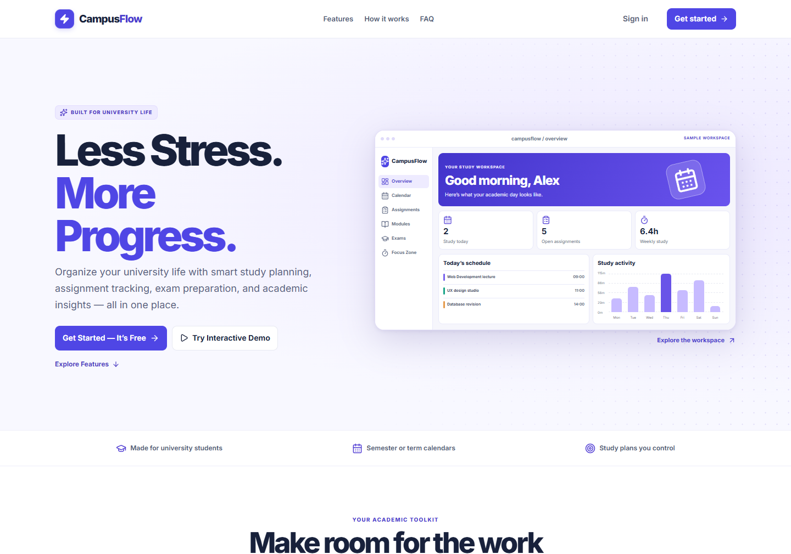
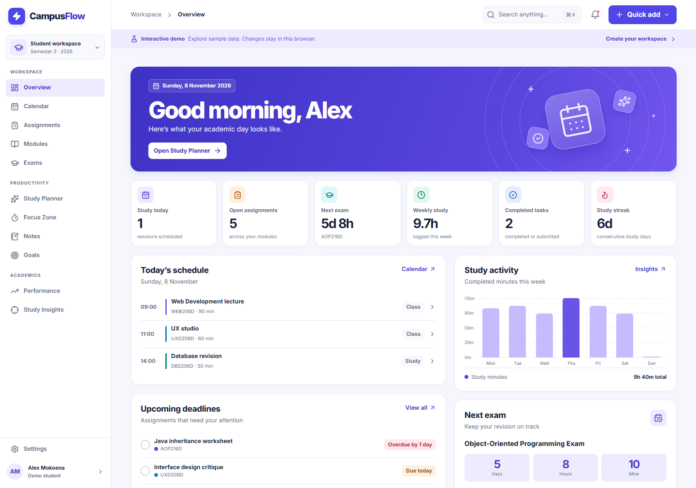

# CampusFlow

**Your Academic Life, Organized.**

CampusFlow is a student productivity workspace built for a Multimedia Computing portfolio at Tshwane University of Technology. It brings coursework, examinations, revision, study time and academic progress into one place. Students at other institutions can use their own semester or term calendar and time zone.

The public landing page links to an interactive demo with five fictional modules and editable coursework, marks, study history and goals. The demo uses browser storage and can be reset in Settings. Authenticated workspaces use private Firestore records.

## Screenshots

| Landing page | Student dashboard |
| --- | --- |
|  |  |

[Mobile dashboard](docs/mobile.png) · [Dark dashboard](docs/dark.png)

## Features

- Dashboard with today's schedule, deadline priorities, exam countdown, study activity and quick actions.
- Module management with archive, restore and confirmed deletion. Deletion preserves associated records and labels the missing module.
- Assignment list, board and filtered calendar with checklists, resource links, priorities and submission tracking.
- Exam preparation with linked study sessions, real countdowns and topic and study-time progress.
- A deterministic Study Planner that ranks work by urgency, assessment importance, difficulty and confidence. Preview, edit, lock or regenerate sessions before accepting. Export an iCalendar file or use the print layout to save a PDF.
- Academic calendar with month, week, day and agenda views. Move entries by dragging on desktop or using the event editor. Dates use the configured IANA time zone, with Africa/Johannesburg as the default.
- Timestamp-based Pomodoro and focus timers, study history, weighted marks, target calculator, consistency trends and academic goals.
- Search and quick commands with Ctrl+K or Cmd+K, plain-text notes with limited formatting, optional achievements, persisted themes and responsive navigation.
- In-app reminders, browser notifications while CampusFlow is open and optional scheduled Firebase Cloud Messaging.
- Email registration, Google sign-in, verification and reset messages, onboarding, workspace export and server-side account deletion.

## Stack and layout

React, TypeScript strict mode, Vite, Tailwind CSS, React Router, Lucide, Recharts, Motion, React Hook Form, Zod, date-fns and Firebase. Vitest, React Testing Library, Playwright and Firebase Emulator Suite cover domain, UI, browser and authorization flows.

```text
src/
  app/                 Workspace providers, navigation and record actions
  components/          Accessible UI, forms, calendar, note rendering and hooks
  domain/              Record types, timezone helpers, planner and calculations
  pages/               Landing, account and student workspace screens
  services/            Firebase configuration, demo storage and push registration
firebase/
  functions/           Account cleanup, shared reminder policy and scheduled push
public/                Brand icon and notification service worker
tests/                 Playwright and Firestore authorization tests
docs/                  Portfolio screenshots
firebase.json          Hosting, Functions and Emulator configuration
firestore.rules         Ownership rules and field checks
firestore.indexes.json  Index and expiry policy
```

## Run the interactive demo

Use Node.js 22.12+ and npm. Use Node 22 for parity with the Cloud Functions runtime.

```sh
npm ci
npm run dev
```

Open [the local landing page](http://localhost:5173) and choose **Try Interactive Demo**. You can also go directly to `/demo`. Leave Firebase environment values blank for demo-only development. To review the bundled app, run `npm run build` and then `npm run preview`.

## Portfolio demo on GitHub Pages

[Open the CampusFlow portfolio demo](https://edwinlebo.github.io/CampusFlow/).

GitHub Pages publishes the demo build from `.github/workflows/pages.yml`. Visitors use a fictional workspace and can make changes that stay in their own browser. The demo build omits account forms. The Firebase build provides registration, sign-in, email verification and password reset.

In a new repository, select **Settings → Pages → Source → GitHub Actions** and run **Deploy CampusFlow demo**. The workflow detects the repository base path. For a local preview of the same build, run:

```sh
npm run build -- --mode pages --base /CampusFlow/
npm run preview -- --base /CampusFlow/
```

Open the printed address under `/CampusFlow/`. This build uses hash routes so shared demo links and refreshes work on static hosting. GitHub's guidance reserves GitHub Pages for the portfolio showcase and advises against sending passwords through Pages. [GitHub Pages limits](https://docs.github.com/en/pages/getting-started-with-github-pages/github-pages-limits)

## Run accounts locally

Install Java 21 or later for the Firestore emulator, and install the function dependencies. Copy `.env.example` to `.env.local` and set `VITE_USE_EMULATORS=true`.

```sh
npm ci
npm ci --prefix firebase/functions
npx firebase emulators:start --project demo-campusflow --only auth,firestore,functions
```

In a second terminal run `npm run dev`, then register at `/register`. Test verification and password reset links appear in the emulator terminal. Restart Vite after changing environment values. The emulator project is for local testing and uses synthetic configuration.

## Connect a Firebase project

1. Create or select a Firebase project, register a web app and create the default Cloud Firestore database in Standard edition. Use the Firebase web app configuration in `.env.local`.
2. In Authentication, enable **Email/Password** and **Google**, configure the Google provider's support email and add your hosting and local development domains to **Authorized domains** as needed. Configure the email templates for verification and password reset.
3. Use `VITE_USE_EMULATORS=false` for a hosted build. Install the function dependencies and deploy the rules and account-cleanup function alongside Hosting.

| Variable | Value |
| --- | --- |
| `VITE_USE_EMULATORS` | `true` for local emulators, `false` or blank for live Firebase |
| `VITE_FIREBASE_API_KEY` | Web API key |
| `VITE_FIREBASE_AUTH_DOMAIN` | Auth domain from the web app configuration |
| `VITE_FIREBASE_PROJECT_ID` | Firebase project ID |
| `VITE_FIREBASE_APP_ID` | Firebase web app ID |
| `VITE_FIREBASE_VAPID_KEY` | Optional public Web Push key after scheduled reminders are deployed |
| `VITE_FIREBASE_MESSAGING_SENDER_ID` | Messaging sender ID from the web app configuration when using push |

The Vite values are public client configuration. The Admin SDK runs only inside Cloud Functions with the project's runtime identity. Privileged credentials belong outside both the frontend bundle and the repository.

[Firebase web setup](https://firebase.google.com/docs/web/setup) · [Google sign-in setup](https://firebase.google.com/docs/auth/web/google-signin) · [Emulator Suite configuration](https://firebase.google.com/docs/emulator-suite/install_and_configure)

## Build and deploy

Use a project you administer. In the commands below, replace `YOUR_FIREBASE_PROJECT_ID` with its actual ID. Cloud Functions deployment requires Blaze billing. The Hosting rewrite supports refreshing nested React routes. The Functions runtime service account needs access to Firestore and Firebase Authentication. The scheduled function also needs permission to send FCM messages.

```sh
npm ci
npm ci --prefix firebase/functions
npm run build
npx firebase login
npx firebase deploy --only firestore:rules,firestore:indexes,functions:deleteWorkspace,hosting --project YOUR_FIREBASE_PROJECT_ID
```

For a portfolio demo without live accounts, leave Firebase values blank, build again and deploy only `hosting` to your chosen project.

[Firebase Hosting configuration](https://firebase.google.com/docs/hosting/full-config) · [Deploy Cloud Functions](https://firebase.google.com/docs/functions/manage-functions)

### Optional scheduled push

In-app reminders work without scheduled infrastructure. Browser reminders use notification permission and a service worker on supported browsers while the app is open. For scheduled delivery, enable Firebase Cloud Messaging and the FCM Registration API as applicable to your project, generate a Web Push key pair in Firebase, copy the messaging sender ID from the web app configuration, and configure the public key as `VITE_FIREBASE_VAPID_KEY`. Deploy the scheduler on Blaze and serve the app over HTTPS.

```sh
npx firebase deploy --only firestore:rules,firestore:indexes,functions:sendStudyReminders --project YOUR_FIREBASE_PROJECT_ID
npm run build
npx firebase deploy --only hosting --project YOUR_FIREBASE_PROJECT_ID
```

Sign in, opt in from Settings and test on a supported browser with a near-term deadline. The job checks for deadlines, exams and scheduled study every 15 minutes. Push text uses generic messages so titles and marks stay out of lock-screen notifications. Daily study goal reminders are evaluated in-app. Delivery depends on device permission, browser support and the network. Device registration expires after 45 days.

[Set up FCM for web](https://firebase.google.com/docs/cloud-messaging/web/get-started) · [Scheduled Functions](https://firebase.google.com/docs/functions/schedule-functions)

## Data and privacy

- User records are under `users/{uid}` with separate collections for modules, assignments, exams, sessions, events, assessments, notes, goals and read reminders. Workspace screens subscribe to their own account's records and derive counts and charts from those records. Demo data uses an unrelated local storage key and does not reach Firestore.
- The rules deny cross-account and anonymous access and restrict writable collections and field ranges. Push token registration is write-only to the device owner. Sending and account deletion use server privileges.
- Account deletion requires a recent sign-in, locks further client writes, recursively deletes Firestore data and then deletes the Firebase Auth user. Failed cleanup can be retried. A restricted UID lock expires after successful cleanup so a previously issued token cannot recreate data.
- Users can export their profile and academic records as JSON. Demo and active focus state use browser storage. Scheduled notifications use short-lived device records and delivery receipts.
- Assessment averages use recorded weights only. A final grade is available at 100% recorded weight. The calculator assumes one common percentage across the remaining weight.
- A study streak counts completed study on consecutive local dates. The current streak remains active if the latest completed day was yesterday.

## Test

```sh
npm test
npm run test:e2e
npm run test:emulator
npm run build
```

The emulator suite runs Firestore Rules tests and an authenticated Playwright flow against Auth, Firestore and Functions. Run it with any existing emulators stopped. For browser tests, install Playwright Chromium with `npx playwright install chromium` or set `PLAYWRIGHT_CHROMIUM_PATH` to an installed Chromium executable. The config also recognizes Chrome's standard Windows install location.

## Current limits

- Live Google OAuth, scheduled push delivery and hosting require a configured Firebase project. Local authentication, persistence and server cleanup are exercised using emulators.
- Drag-and-drop is available on the academic calendar where the browser supports it. Edit planner drafts directly in the timetable, and use the browser's print dialog to save a PDF.
- The workspace loads one real-time subscription per declared academic collection and filters locally. A future large-workspace version could paginate archive/history views and move full-text search to an indexed service.
- The scheduler is designed for a small portfolio deployment. Higher-volume deployments would benefit from queued, incremental scheduling and delivery monitoring. No live project has been deployed.
- Future improvements include recurring calendar events and richer note formatting. The deployed application's operator determines the relevant retention and privacy notices.

## Portfolio summary

CampusFlow demonstrates React UI engineering, Firebase authorization, deterministic constraint-based scheduling, timezone-safe calendars and academic data visualization. The portfolio demo is fully explorable without an account.

## Verified in this build

- 10 Vitest unit and component checks passed.
- Five Chromium demo workflows passed, including offline-independent demo persistence, calendar navigation, focus logging, planner export and browser reminder deduplication.
- Five Firestore Rules checks, one scheduler integration check with a simulated FCM sender and one authenticated browser workflow passed in the Firebase Emulator Suite.
- TypeScript and the Vite production build passed. All 13 workspace routes were opened in the production bundle at widths of 320, 768 and 1440 pixels.
